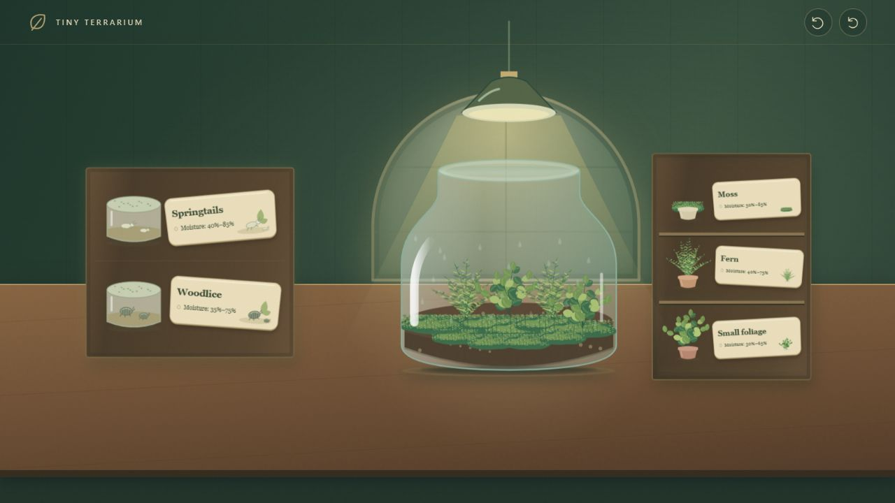

# Tiny Terrarium — Guided Grow

The vintage greenhouse now uses object-based handoffs with no written step instructions or Finish buttons. Placing soil reveals plants on the opposite side while soil remains available. Picking up a plant hides soil. Placing the first plant reveals creatures on the left; users can keep planting all nine slots until they pick up a creature. Placing a creature reveals the sprayer on the right; users can add both species until they pick up the sprayer. Then only watering remains. Click and drag both support pickup handoffs; undo restores earlier stages.

Springtails and woodlice render in the foreground above foliage and glass overlays, at larger scales and with bounded movement. Watering visibly increases plant growth from 0.68 to 1.45, with no timed simulation or overwatering penalty. Undo and reset remain available.

- `dist/index.html`: updated first version
- `dist/greenhouse-previous.html`: preserved earlier first version
- The independent wordless variant remains in its own branch and hosted entry.
- `dist/guided-model.js`: stage and growth rules
- `dist/guided.js`: accessible stage-specific UI
- `dist/guided-art.js`: foreground residents
- `dist/assets/guided/`: 5 additional exported SVGs

Run model tests and tests/guided-journey.mjs. tests/journey.mjs checks the preserved previous UI.

## 完整元素下载

[素材清单](ASSETS.md) · [94 个 SVG 总览源码](dist/assets/vintage/index.html) · [完整素材 ZIP](downloads/Tiny-Terrarium-All-Assets.zip) · [离线试玩 HTML](downloads/Tiny-Terrarium-Playable.html) · [文件校验清单](ASSET-INVENTORY.json)

