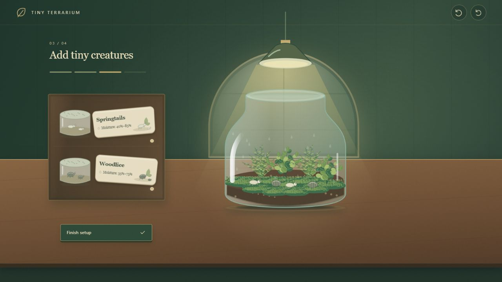

# Tiny Terrarium — Guided Grow

The first greenhouse layout now follows four stages: add soil, plant any of nine positions, add one or both creature species, then water and grow. Only the active stage materials are displayed. Finish planting and Finish setup confirm the two open-ended stages. Lighting is fixed; there are no day, autoplay, or result controls.

Springtails and woodlice render in the foreground above foliage and glass overlays, at larger scales and with bounded movement. Watering visibly increases plant growth from 0.68 to 1.45, with no timed simulation or overwatering penalty. Undo and reset remain available.

- `dist/index.html`: updated first version
- `dist/greenhouse-previous.html`: preserved earlier first version
- The independent wordless variant remains in its own branch and hosted entry.
- `dist/guided-model.js`: stage and growth rules
- `dist/guided.js`: accessible stage-specific UI
- `dist/guided-art.js`: foreground residents
- `dist/assets/guided/`: 5 additional exported SVGs

Run model tests and tests/guided-journey.mjs. tests/journey.mjs checks the preserved previous UI.

## 完整元素下载

[素材清单](ASSETS.md) · [94 个 SVG 总览源码](dist/assets/vintage/index.html) · [完整素材 ZIP](downloads/Tiny-Terrarium-All-Assets.zip) · [离线试玩 HTML](downloads/Tiny-Terrarium-Playable.html) · [文件校验清单](ASSET-INVENTORY.json)

